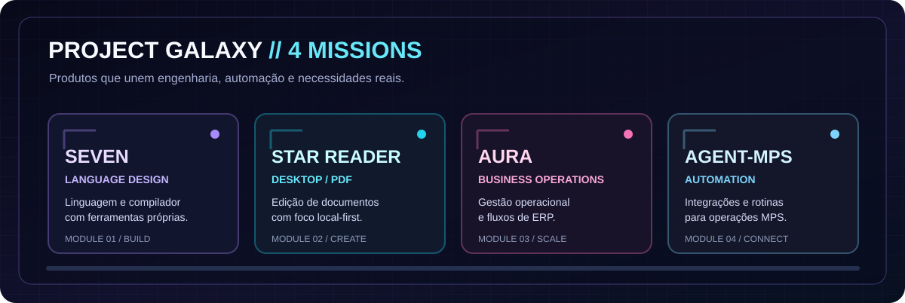

<div align="center">
  
</div>

<p align="center">
  <a href="https://portif-lio-api-server-kappa.vercel.app">Portfolio</a>
  &nbsp;|&nbsp;
  <a href="https://sevenstarstechnology.com.br">Seven Stars Technology</a>
  &nbsp;|&nbsp;
  <a href="https://github.com/gabriell211/Seven">Seven Language</a>
  &nbsp;|&nbsp;
  <a href="https://github.com/gabriell211/Seven/blob/main/docs/references.md">Seven References</a>
  &nbsp;|&nbsp;
  <a href="https://www.linkedin.com/in/gabriel-barcelos-6a3979407">LinkedIn</a>
  &nbsp;|&nbsp;
  <a href="https://www.instagram.com/g4b_seo">Instagram</a>
</p>

## Visao Executiva

Sou Gabriel Barcelos, desenvolvedor focado em transformar processos complexos em produtos digitais claros, confiaveis e escalaveis.

Minha entrega combina engenharia de software, visao de negocio e cuidado com a experiencia de uso. Trabalho principalmente com sistemas de gestao, automacao, ferramentas desktop, produtos web e infraestrutura local-first.

```txt
Foco principal      Sistemas empresariais, automacao e produtos digitais
Perfil tecnico     Full stack, desktop apps, integracoes e infraestrutura
Diferencial        Entender o problema de negocio antes de escrever codigo
```

## Agora

- Evoluindo a **Seven**, uma linguagem de programacao propria com extensao `.sev` e compilador `seven`.
- Evoluindo o **Star Reader**, um leitor/editor PDF local-first para uso profissional.
- Construindo sistemas para operacoes reais: atendimento, gestao, vendas, automacao e controle.
- Transformando processos manuais em produtos digitais mais simples, seguros e sustentaveis.

## Stack Principal

<div align="center">
  
</div>

## Produtos em Destaque

| Projeto | Papel | Resultado |
|---|---|---|
| [Seven](https://github.com/gabriell211/Seven) | Criador da linguagem `.sev` e do compilador `seven` | Fundacao de linguagem, biblioteca padrao, runtime, docs, exemplos e identidade oficial |
| [Star Reader](https://github.com/gabriell211/star-reader) | Produto desktop local-first para PDF | OCR, assinaturas, formularios, anotacoes, organizacao de paginas e revisao |
| [Aura](https://github.com/gabriell211/Aura) | Sistema ERP MPS | Controle operacional e gestao de processos |
| [Agent-Mps](https://github.com/gabriell211/Agent-Mps) | Automacao operacional | Suporte para operacoes MPS e rotinas de produtividade |
| [vertex](https://github.com/gabriell211/vertex) | Base de produto digital | Estrutura moderna para desenvolvimento web |

## Engenharia na Pratica

<div align="center">
  
</div>

## Como Eu Construo

- Entendo o fluxo real do usuario, o gargalo e o custo operacional do problema.
- Desenho uma solucao simples de operar, com interface clara e regras previsiveis.
- Entrego codigo organizado, versionado e preparado para evoluir sem retrabalho.
- Penso em instalacao, seguranca, manutencao, suporte e distribuicao desde cedo.

## Contato

<p align="center">
  <a href="https://gabriel-barcelos.help">gabriel-barcelos.help</a>
  &nbsp;|&nbsp;
  <a href="https://sevenstarstechnology.com.br">sevenstarstechnology.com.br</a>
  &nbsp;|&nbsp;
  <a href="https://github.com/gabriell211">github.com/gabriell211</a>
</p>

<div align="center">
  
</div>
