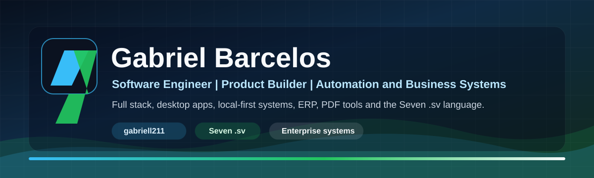
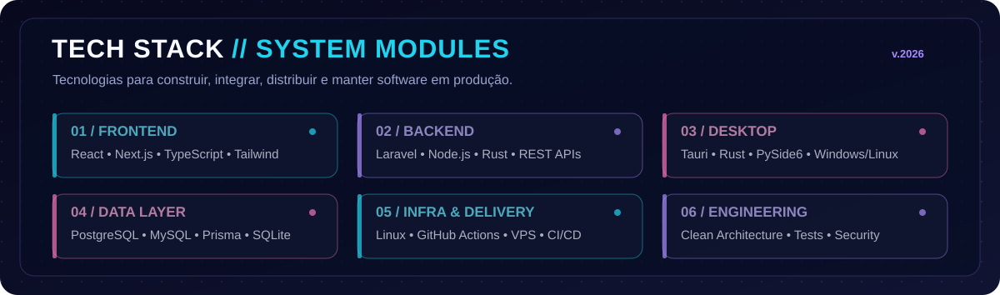

  

  

    <a href="https://portif-lio-api-server-kappa.vercel.app">Portfólio</a> ·
    <a href="https://sevenstarstechnology.com.br">Seven Stars Technology</a> ·
    <a href="https://www.linkedin.com/in/gabriel-barcelos-6a3979407">LinkedIn</a> ·
    <a href="https://www.instagram.com/g4b_seo">Instagram</a>
  

  <strong>SOFTWARE ENGINEER • PRODUCT BUILDER • AUTOMATION</strong>
  
Desenvolvendo o que vem depois — com arquitetura, propósito e execução.

---

## 01 // IDENTIDADE DIGITAL

~~~text
╔══════════════════════════════════════════════════════════╗
║  > whoami                                               ║
║  NAME       Gabriel Barcelos                             ║
║  USER       @gabriell211                                 ║
║  ROLE       Software Engineer / Product Builder          ║
║  FOCUS      Full Stack · Desktop · Automação · Sistemas  ║
║  APPROACH   Segurança · Performance · Escalabilidade      ║
╚══════════════════════════════════════════════════════════╝
~~~

Transformo necessidades reais em **produtos digitais, integrações e sistemas confiáveis**. Atuo da arquitetura à distribuição: da experiência de uso ao backend, da infraestrutura à automação de processos.

Meu foco não é apenas fazer o código funcionar. É construir software que seja **simples de operar, seguro de manter e preparado para crescer**.

## 02 // TECH UNIVERSE

  

  <code>REACT</code> · <code>NEXT.JS</code> · <code>TYPESCRIPT</code> · <code>LARAVEL</code> · <code>RUST</code> · <code>TAURI</code> · <code>POSTGRESQL</code> · <code>CI/CD</code>

**Princípios de engenharia:** Clean Architecture, SOLID, tipagem forte, testes automatizados, observabilidade, controle de acesso, otimização de consultas e interfaces acessíveis.

## 03 // PROJECT GALAXY

  

| Projeto | Missão | Área |
| :--- | :--- | :--- |
| **[Seven](https://github.com/gabriell211/Seven)** | Desenvolvimento de uma linguagem própria, compilador, runtime, documentação e ferramentas. | Linguagens &amp; tooling |
| **[Star Reader](https://github.com/gabriell211/star-reader)** | Leitura e edição profissional de PDF em uma experiência desktop local-first. | Desktop &amp; documentos |
| **[Aura](https://github.com/gabriell211/Aura)** | Gestão de operações e processos empresariais em ambiente MPS. | ERP &amp; operações |
| **[Agent-Mps](https://github.com/gabriell211/Agent-Mps)** | Integrações e automações para rotinas de operações MPS. | Automação &amp; integração |
| **[vertex](https://github.com/gabriell211/vertex)** | Base para construção e evolução de produtos web modernos. | Web &amp; arquitetura |

> **Construir para uso real.** Uma interface bonita importa, mas consistência, estabilidade, manutenção e evolução importam tanto quanto.

## 04 // ENGINEERING PROTOCOL

~~~text
[01] DISCOVER     → Entender a operação e os problemas reais
[02] ARCHITECT   → Definir limites, contratos e responsabilidades
[03] BUILD       → Implementar com legibilidade e segurança
[04] VALIDATE    → Testes, revisão, build e casos de exceção
[05] SHIP        → Distribuir com rastreabilidade e controle
[06] EVOLVE      → Medir, corrigir e melhorar continuamente
~~~

<strong>▸ Explorar minha forma de trabalhar</strong>

- **Backend:** regras de negócio isoladas, APIs previsíveis, autenticação, autorização e consultas eficientes.
- **Frontend:** componentes acessíveis, estados bem definidos, responsividade e integração consistente.
- **Desktop & infraestrutura:** distribuição, compatibilidade, segurança operacional e experiência local-first.
- **Entrega:** versionamento, revisão, CI, testes e cuidado com regressões.

## 05 // OPEN CHANNEL

  

    <a href="https://gabriel-barcelos.help">Website</a> ·
    <a href="https://sevenstarstechnology.com.br">Empresa</a> ·
    <a href="https://github.com/gabriell211/Seven">Seven Language</a> ·
    <a href="https://github.com/gabriell211/Seven/blob/main/docs/references.md">Referências técnicas</a>
  

  <a href="https://github.com/gabriell211">github.com/gabriell211</a>

  

Visualizações em SVG animado hospedadas neste repositório. A animação respeita a preferência de movimento reduzido do dispositivo.
