  

  
<strong>Engenharia de software · Arquitetura de sistemas · Infraestrutura · Produtos digitais</strong>

  

    <a href="https://gabriel-barcelos.help">Portfólio</a> ·
    <a href="https://sevenstarstechnology.com.br">Seven Stars Technology</a> ·
    <a href="https://www.linkedin.com/in/gabriel-barcelos-6a3979407">LinkedIn</a>
  

---

## Sobre mim

Sou **Gabriel Barcelos**, `gabriell211`, desenvolvedor dedicado à construção de sistemas, aplicações e ferramentas para problemas reais. Trabalho entre **frontend, backend, desktop e infraestrutura**, com atenção especial à arquitetura, segurança, desempenho e experiência de uso.

Crio soluções para automação, redes, gestão empresarial e documentos. Também desenvolvo a **Seven**, minha própria linguagem de programação, com extensão `.sev`.

## Tecnologias

**Linguagens:** PHP · Rust · TypeScript · JavaScript · Python · C · C++ · C# · SQL

**Desenvolvimento:** Laravel · React · Next.js · React Native · Tauri · Flutter

**Dados e infraestrutura:** PostgreSQL · MySQL · SQLite · Redis · Linux · GitHub Actions · APIs REST

## Projetos selecionados

### [Seven — Linguagem de programação](https://github.com/gabriell211/Seven)
Linguagem autoral com arquivos `.sev`, compilador `seven`, runtime, biblioteca padrão e toolchain. O repositório documenta builds para Windows, Linux, SVBC e web.

### [Seven Network Manager](https://github.com/gabriell211/Seven-Network-Manager)
Plataforma para gerenciamento de infraestrutura de rede, com frontend **Next.js**, plano de controle **Rust/Axum** e runtime local headless. Fundação arquitetural em evolução para inventário, IPAM, descoberta e telemetria.

### [HYDRA Network Control](https://github.com/gabriell211/Mikrotk-Painel)
Painel de administração MikroTik RouterOS com funções de backend para isolar credenciais do navegador. Abrange visão geral, DHCP, ARP, interfaces, VLANs, firewall e configuração de SMTP.

### [Aura ERP MPS](https://github.com/gabriell211/Aura)
ERP SaaS multi-tenant para outsourcing de impressão, construído com **Laravel 12**. Inclui base de clientes, contratos, equipamentos, contadores e processos de faturamento e atendimento técnico.

### [Seven Reader Mobile](https://github.com/gabriell211/Seven-Reader-mobile)
Aplicativo para Android e iOS baseado em **Flutter**, com foco em leitura e organização local-first de documentos PDF. Complementa o trabalho no Seven Reader desktop, que está em reconstrução.

### [Seven Code](https://github.com/gabriell211/Seven-code)
Projeto de editor multiplataforma baseado em **Code - OSS**, com marca própria. As integrações e a homologação completa ainda estão em desenvolvimento.

### [FiveM Map Forge](https://github.com/gabriell211/fivem-maps)
Pipeline de criação de cenários para FiveM com descrição em linguagem natural, preview 3D e exportação utilizando Blender e Sollumz.

## Como trabalho

Da modelagem à entrega, priorizo **separação de responsabilidades**, contratos claros, proteção de dados, testes e manutenção sustentável. Funcionalidades em desenvolvimento são identificadas como tal: uma interface ou um build bem-sucedido não substitui homologação real.

  
<strong>Build with purpose. Engineer for the long term.</strong>

  <a href="https://github.com/gabriell211">github.com/gabriell211</a>

